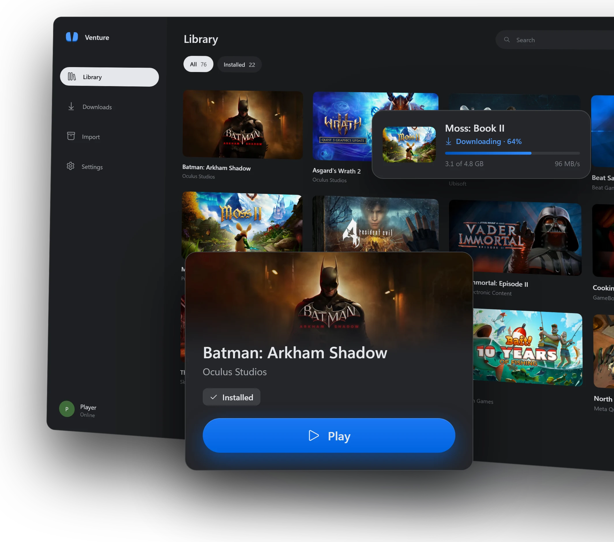
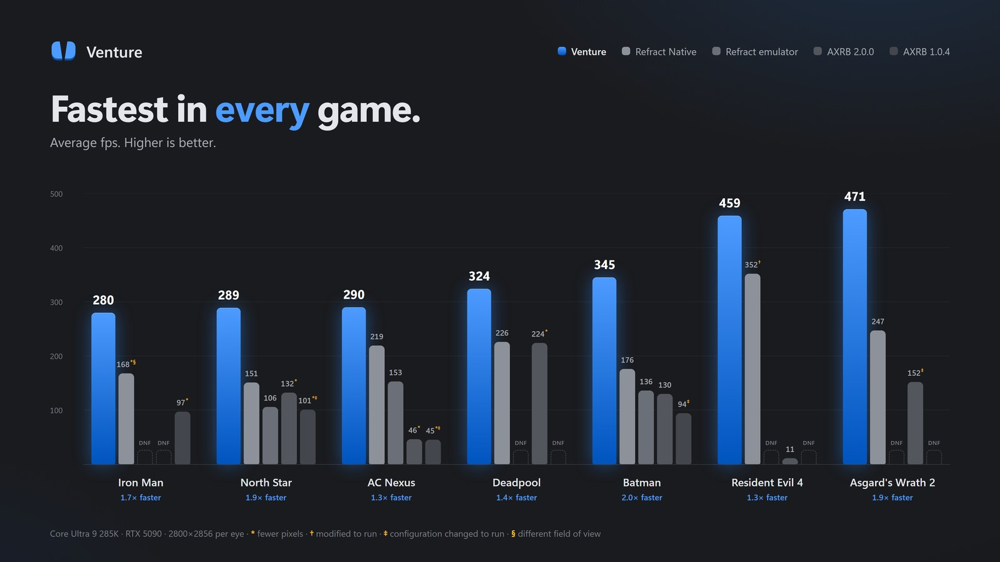
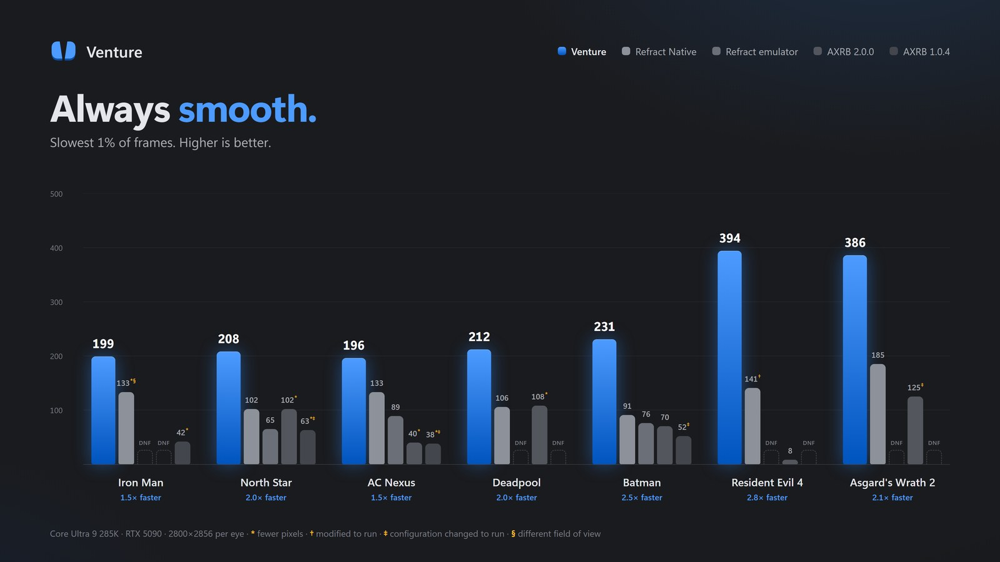
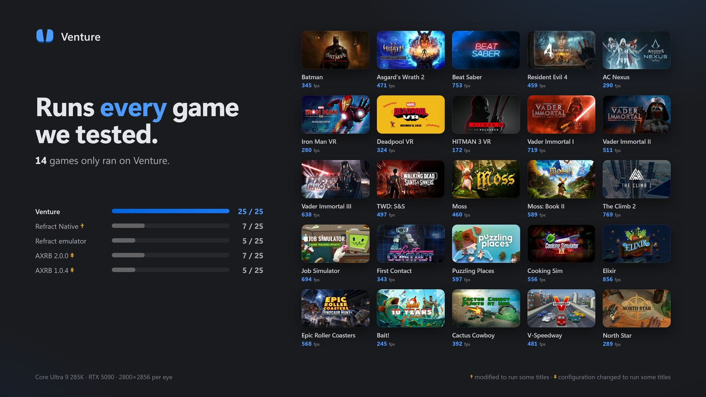

<div align="center">


# Venture: Unknown Source Edition

**A Meta Quest emulator for PC VR.**

Play the Meta Quest games you own on your PC headset, at full PC speed and resolution.<br>
No virtual machine. Free and open source.

This is a fork of [Venture](https://github.com/Villagers654/Venture) by Villagers654 that adds an opt-in **dev identity** for
development builds and apps from outside the Meta store. See [What's different in this fork](#whats-different-in-this-fork).

[**Download**](https://github.com/DeliciousMeatPop/Venture-UnknownSourceEdition/releases/latest) · [Report an issue](https://github.com/DeliciousMeatPop/Venture-UnknownSourceEdition/issues) · [Upstream project](https://github.com/Villagers654/Venture)

<a href="https://ko-fi.com/Villagers654"></a><br>
<sub>This Ko-fi button supports Villagers654, the author of upstream Venture. It does not go to the maintainer of this fork.</sub>



</div>

## Credit where it's due

**Everything that matters here was built by [Villagers654](https://github.com/Villagers654).** Venture is his project: the ARM JIT integration, the Quest runtime and platform services, the OpenXR renderer, the launcher, the installer and packaging, the test suite, the compatibility work behind "25 games out of 25", and the countless hours of reverse-engineering and debugging that made running Quest games on PC feel easy. This fork adds one small opt-in feature on top of that foundation, and it would not exist without his work.

Thank you, Villagers654, for building something this ambitious, this fast and this well, and for releasing it as free and open source so that others can build on it. If Venture is useful to you, please support him directly: [star the upstream project](https://github.com/Villagers654/Venture) and use the Ko-fi button above. Anything that also happens in upstream Venture should be reported [to him](https://github.com/Villagers654/Venture/issues), not to this fork.

## Why Venture

- **Fast.** Venture is by far the fastest way to play Quest games on PC, with steady frame times.
- **Compatible.** Runs all 25 games we tested; see the [upstream compatibility wiki](https://github.com/Villagers654/Venture/wiki/Compatibility). The next best runs 7.
- **Straight to your hardware.** Every game runs as an ordinary PC process that renders on your GPU and talks to your headset through OpenXR.
- **Simple.** Sign in with Meta, install, press Play. Your games can show up in your Steam library too.







## What's different in this fork

This fork tracks upstream Venture and adds one thing: a **dev identity** for apps that can't sign in through the Meta store, such as your own builds or games from other stores.

- **What it does.** An app with dev identity starts as a local "Developer" user: no Meta account is read or contacted, platform calls (user, leaderboards, achievements, in-app purchase reads) get local answers, and the ownership check is not performed.
- **Off by default, per app.** Nothing changes for any app you don't opt in. Store games keep Meta sign-in, ownership checks and purchases exactly as upstream.
- **Turn it on.** Press **Play** on a game whose package name has a `dev` segment (for example `com.dev.studio.game` or `dev.studio.game`) and the launcher asks once. For any other app, open the game's **more** menu and choose **Use dev identity**. From a terminal: `venture-cli play GAME --dev-identity` (saved), `--no-dev-identity` to turn it off.
- **Visible.** The game's page shows a **DEV IDENTITY** badge while it is on, and the logs say so.
- **Updates.** The launcher's update check follows this fork's [releases](https://github.com/DeliciousMeatPop/Venture-UnknownSourceEdition/releases), not upstream's.

Dev identity is for developers and for software that isn't sold through the Meta store. Read the [disclaimer](#dev-identity-disclaimer) before using it.

### Install and play

1. Download `Venture-windows64-setup.exe` from [Releases](https://github.com/DeliciousMeatPop/Venture-UnknownSourceEdition/releases/latest) and run it.
   On Linux, install the package for your distribution (`.deb`, `.rpm`, AUR `venture-bin`, AppImage or Flatpak), or extract the `.tar.gz` anywhere.
2. Start Venture and choose Sign in with Meta and use the account that owns your Quest games.
   If Meta's sign-in window doesn't open, or you'd rather use your own browser, choose **Sign in manually** under it.
3. Pick a game in your library and choose **Install**.
4. Start your headset's runtime, then choose **Play**.

### Games from somewhere else

The **Import** page adds games that aren't in your Meta library:

- **From a headset:** connect a Quest with developer mode on (USB, or Wi-Fi debugging) and choose **Scan headset**. Nothing on the headset is changed.
- **From this computer:** choose or drop an APK, a ZIP, or a folder with the APK and its data.

An imported development build or an app from another store has no Meta listing to sign in against; turn on **dev identity** for it (see above).

### Play from Steam

Turn on **Add games to Steam** in Settings. Installed games appear in Steam and SteamVR the next time Steam starts.

### Mods

Mods that replace a game's expansion file (OBB), such as RE4 VR Definitive Edition, go in the game's mods folder: open the game in your library and choose **Open folder** next to **Mods**, then put the mod's file there under the same name as the installed file (for example `main.203.com.Armature.VR4.obb`). It is used from the next launch; your installation is not changed, and deleting the file goes back to the original.

### Mixed reality (passthrough)

Games that use Quest passthrough show your surroundings when your VR runtime or
headset can: through the runtime's own passthrough (`XR_FB_passthrough` or
`XR_HTC_passthrough`), its see-through blend mode, the headset's cameras through
SteamVR, or (for now) the Steam Link native passthrough companion. A color key
for streaming tools that key a color can be chosen instead. It is on by default;
**Settings → Runtime → Passthrough (mixed reality)** keeps every game in VR. See [Mixed Reality](https://github.com/Villagers654/Venture/wiki/Mixed-Reality) on the upstream wiki for known setups.

### Something wrong?

If a game crashes, click **Report issue** on the banner that appears. Otherwise, use **Upload debug report** in Settings. Either way, Venture collects the launcher and game logs from your last launch into one debug report, uploads it as an unlisted paste that expires after 90 days, and gives you a link to copy. If the upload fails, attach the report file instead (**Show file**). The report starts with what happened in the last run and its likely cause; `venture-cli report [GAME] --upload` writes the same from a terminal.

[Open an issue](https://github.com/DeliciousMeatPop/Venture-UnknownSourceEdition/issues/new/choose) with the game, what happened, how to make it happen again and the debug report link. To watch a game's output live, turn on **Show runtime console** in Settings. Problems that also happen in upstream Venture are best reported [upstream](https://github.com/Villagers654/Venture/issues).

### Build (Windows)

```sh
python tools/bootstrap.py --jdk --angle      # pinned toolchain, JDK and ANGLE into .deps/
.deps/cmake/bin/cmake --preset windows-release
.deps/cmake/bin/cmake --build --preset windows-release
```

### Build (Linux)

```sh
python3 tools/bootstrap.py --jdk             # pinned CMake, Ninja and JDK into .deps/
.deps/cmake/bin/cmake --preset linux-release
.deps/cmake/bin/cmake --build --preset linux-release
```

## License

Venture is licensed under GPL-3.0-or-later: see [LICENSE](LICENSE).

It's built on other people's work, and we're grateful for it. Code from these projects is used under their own licenses, kept in [LICENSES/](LICENSES):

| License | Whose code |
|---|---|
| [GPL-3.0-or-later](LICENSE) | [Eden](https://eden-emu.dev/)'s fork of Dynarmic, by the Eden Emulator Project |
| [0BSD](LICENSES/0BSD.txt) | [Dynarmic](https://github.com/merryhime/dynarmic), by merryhime (MerryMage) and its contributors |
| [MIT](LICENSES/MIT.txt) | [musl](https://musl.libc.org/), by Rich Felker et al. |
| [LGPL-2.1](LICENSES/LGPL-2.1.txt) | [FFmpeg](https://ffmpeg.org/), by the FFmpeg developers |

Thank you to the Eden Emulator Project, whose Dynarmic fork Venture's JIT is built on; to merryhime and everyone who has worked on Dynarmic, which made a fast, accurate ARM JIT possible; and to the emulator projects it grew up with and borrows from, yuzu, Citra and Dolphin (Gekko). Thank you also to AXRB for pioneering Quest emulation on PC VR.

Venture is built by Villagers654 and its contributors; this fork by DeliciousMeatPop. Neither is affiliated with Meta; see [DISCLAIMER.md](DISCLAIMER.md).

## Star history

<a href="https://www.star-history.com/?type=date&repos=DeliciousMeatPop%2FVenture-UnknownSourceEdition">
 <picture>
   <source media="(prefers-color-scheme: dark)" srcset="https://api.star-history.com/chart?repos=DeliciousMeatPop/Venture-UnknownSourceEdition&type=date&theme=dark&legend=top-left" />
   <source media="(prefers-color-scheme: light)" srcset="https://api.star-history.com/chart?repos=DeliciousMeatPop/Venture-UnknownSourceEdition&type=date&legend=top-left" />
   
 </picture>
</a>

## Dev identity disclaimer

Dev identity exists so that developers can test their own apps, and so that software distributed outside the Meta store can run, without a Meta account. **Use it only for:**

- applications you wrote or have the rights to test, and
- software that is not distributed through the Meta store and that you are permitted to run.

**Do not use it to run, test or distribute games or other software you have not purchased or are not licensed to use.** It is not a way around ownership, entitlement or licence checks for store titles, and the maintainers do not support or condone that use. Apps you have not opted in are unaffected and keep the normal Meta checks.

This software is provided "as is", without warranty of any kind, express or implied, including merchantability, fitness for a particular purpose and non-infringement, as set out in the [GPL-3.0-or-later](LICENSE). To the fullest extent permitted by law, the authors, maintainers and contributors of this fork and of upstream Venture are not liable for any claim, damages or other liability arising from the use or misuse of this software or of dev identity, including violations of law, platform terms of service or software licences, or loss of accounts or access. You alone are responsible for how you use it and for complying with the laws and terms that apply to you. This section is not legal advice. Venture is not affiliated with or endorsed by Meta, Valve or any game publisher; see also [DISCLAIMER.md](DISCLAIMER.md).
